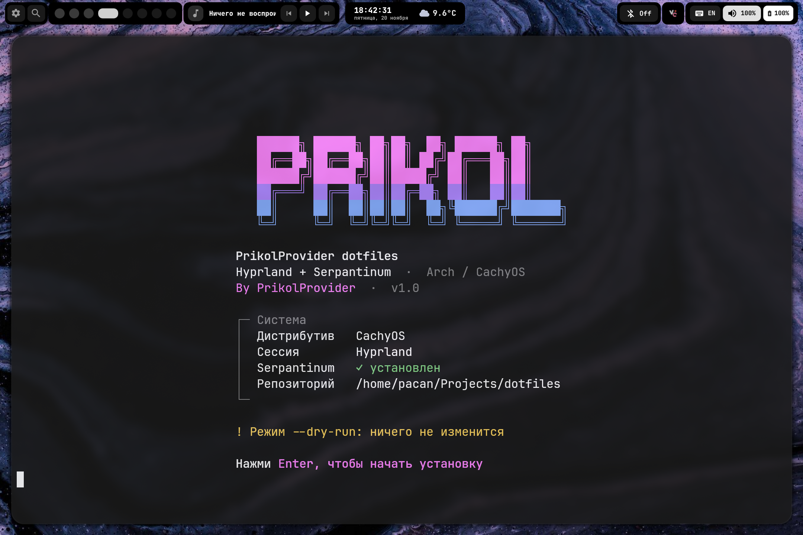
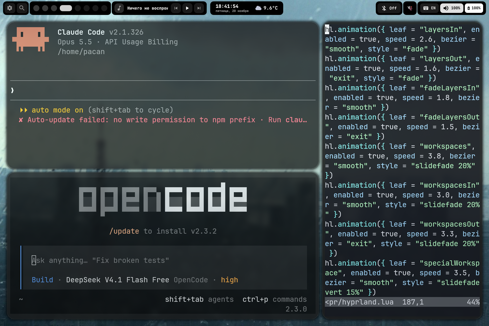
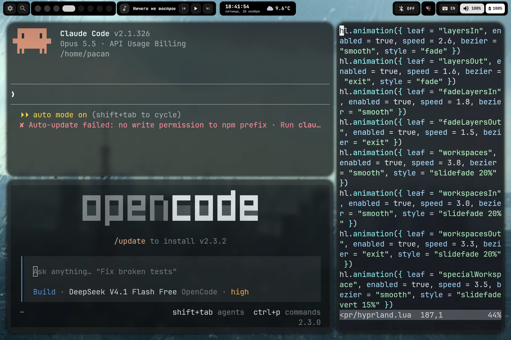
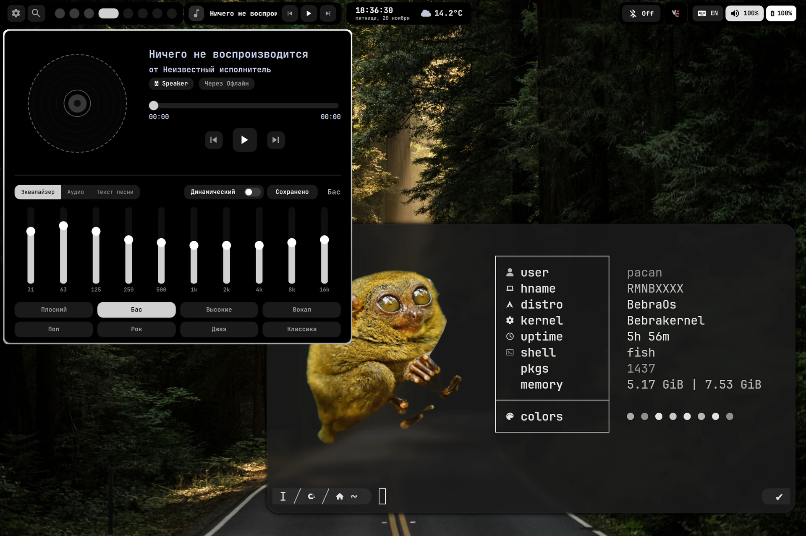

<div align="center">
  
</div>

<h1 align="center">dotfiles</h1>

<p align="center">
  <strong>RU:</strong> Мои конфиги для Hyprland. Собраны под себя, без претензии на универсальность.<br>
  <strong>EN:</strong> My Hyprland dotfiles. Built for myself, no claims of universality.
</p>

<p align="center">
  
  
  
  
  
  
</p>

<p align="center">
  <a href="#-установка--installation">🚀 Установка / Installation</a> ·
  <a href="#-скриншоты--screenshots">📸 Скриншоты / Screenshots</a> ·
  <a href="#-клавиши--keybindings">⌨️ Клавиши / Keybindings</a> ·
  <a href="#-структура--structure">📁 Структура / Structure</a> ·
  <a href="#-пакеты--packages">📦 Пакеты / Packages</a> ·
  <a href="#-faq">❓ FAQ</a> ·
  <a href="#-спасибо--thanks">🙏 Спасибо / Thanks</a>
</p>

---

## 🇷🇺 Русская версия

Это мой рабочий стол. Я не делал из него дистрибутив: часть вещей завязана на железо, часть — на привычки, которые мне лень менять. Но если тебе зайдёт — забирай, мне не жалко.

**Hyprland** у меня на Lua (`hyprland.lua`). Да, я попробовал и оставил. Бар и панели — [Serpantinum](https://github.com/ilyamiro/serpantinum), терминал — kitty, шелл — fish со starship, файлы — ski.

<a href="assets/screenshots/1.png"></a>

<sub>Главный рабочий стол: три окна, cava по центру, Serpantinum бар сверху. Обои тоже лежат в репозитории.</sub>

---

### 🎯 Что внутри

| Компонент | Что использую |
|:---|:---|
| **Оконный менеджер** | Hyprland, конфиг на Lua (`hyprland.lua`) |
| **Бар и панели** | Serpantinum (топ-бар, панель уведомлений, OSD) |
| **Терминал** | kitty + тема Serpantinum |
| **Шелл** | fish + starship prompt |
| **Файловый менеджер** | ski (TUI) + yazi |
| **Лаунчер** | hyprlauncher (SUPER+R) |
| **Запуск приложений** | fuzzel (rofi-подобный) |
| **Тема** | Serpantinum: GTK 3/4, Qt5/6 (Kvantum), kitty, cava, fuzzel |
| **Шрифты** | JetBrainsMono Nerd Font, FiraCode Nerd Font |
| **Обои** | 221 штука в `wallpapers/` (папки `current/` и `hyprconf/`) |
| **Скрипты** | мелочи для себя в `bin/` |
| **Системный мониторинг** | btop, cava, fastfetch |
| **Уведомления** | satty (аннотации скриншотов) + Serpantinum |

Пакеты, из которых это собрано, лежат в `packages/`: **236** из pacman, **16** из AUR, **7** flatpak.

---

## 🇺🇸 English Version

This is my desktop. I didn't make a distro out of it: some things are hardware-specific, some are just habits I'm too lazy to change. But if you like it — take it, I don't mind.

**Hyprland** runs on Lua (`hyprland.lua`). Yes, I tried it and kept it. Bar & panels — [Serpantinum](https://github.com/ilyamiro/serpantinum), terminal — kitty, shell — fish with starship, files — ski.

<a href="assets/screenshots/1.png"></a>

<sub>Main desktop: three windows, cava in center, Serpantinum bar on top. Wallpapers are also in the repo.</sub>

---

### 🎯 What's Inside

| Component | What I Use |
|:---|:---|
| **Window Manager** | Hyprland, config in Lua (`hyprland.lua`) |
| **Bar & Panels** | Serpantinum (top bar, notification panel, OSD) |
| **Terminal** | kitty + Serpantinum theme |
| **Shell** | fish + starship prompt |
| **File Manager** | ski (TUI) + yazi |
| **Launcher** | hyprlauncher (SUPER+R) |
| **App Launcher** | fuzzel (rofi-like) |
| **Theme** | Serpantinum: GTK 3/4, Qt5/6 (Kvantum), kitty, cava, fuzzel |
| **Fonts** | JetBrainsMono Nerd Font, FiraCode Nerd Font |
| **Wallpapers** | 221 in `wallpapers/` (`current/` & `hyprconf/`) |
| **Scripts** | personal utils in `bin/` |
| **System Monitoring** | btop, cava, fastfetch |
| **Notifications** | satty (screenshot annotations) + Serpantinum |

Packages are in `packages/`: **236** pacman, **16** AUR, **7** flatpak.

---

# 🚀 Установка / Installation

Полный пошаговый туториал — от чистой системы до работающего рабочего стола.<br>
Complete step-by-step tutorial — from clean system to working desktop.

### 📋 Что нужно перед стартом / Prerequisites

- **Arch Linux** или производная (у меня **CachyOS** — рекомендую, уже настроен под производительность)
- **Arch Linux** or derivative (I use **CachyOS** — recommended, tuned for performance)
- `git` и `rsync` (нужны для установщика) / `git` and `rsync` (needed for installer)
- ~**500 МБ** свободного места (конфиги + обои + кэш) / ~**500 MB** free space
- Запускать **не от root** — `sudo` установщик попросит сам, где нужно / Run **not as root** — `sudo` asked where needed

```bash
sudo pacman -S --needed git rsync
```

> ⚠️ **Важно / Important**: Если ставишь на чистый Arch (не CachyOS) — некоторые пакеты в `packages/pacman.txt` специфичны для CachyOS (`cachyos-*`, `linux-cachyos`, `cachyos-hello`, и т.д.). Лучше сначала глянуть список и убрать лишнее, или ставить через `--packages` выборочно.<br>
> If installing on pure Arch (not CachyOS) — some packages in `packages/pacman.txt` are CachyOS-specific (`cachyos-*`, `linux-cachyos`, etc.). Check the list first and remove extras, or install selectively via `--packages`.

---

### 1️⃣ Клонируем репозиторий / Clone the repo

```bash
git clone https://github.com/PrikolProvider/PrikolTinum.git ~/dotfiles
cd ~/dotfiles
```

---

### 2️⃣ Смотрим, что будет (dry-run) / Preview with dry-run

Перед установкой **всегда** запускай dry-run — он покажет полный план действий, не трогая файлы.<br>
Always run dry-run first — it shows the full plan without touching files.

```bash
./install.sh --dry-run
```

Откроется полноэкранное интро (очищает терминал, центрирует баннер, печатает ASCII-лого посимвольно):<br>
Opens fullscreen intro (clears terminal, centers banner, types ASCII logo char-by-char):

<a href="assets/screenshots/installer.webp"></a>

Жмёшь **Enter** — установщик покажет план / Press **Enter** — installer shows plan:

```
┌─ System
│  Distro        CachyOS
│  Session       Hyprland
│  Serpantinum   ✓ installed
│  Repository    ~/dotfiles
└─

▸ [1/6] Configs → ~/.config
  ✓ 39 configs
▸ [2/6] Dotfiles → ~/
  ✓ 12 files
▸ [3/6] Scripts → ~/.local/bin
  ✓ 4 scripts
▸ [4/6] Wallpapers → ~/Pictures/Wallpapers
  ✓ 221 wallpapers (with spinner)
▸ [5/6] GTK/Qt themes → applied
▸ [6/6] Fonts → cache updated
```

Никакого мусора в консоли. Видно только шаги и галочки. Если команда упадёт — покажет именно её и её вывод.<br>
No console spam. Only steps and checkmarks. If a command fails — shows exactly that command and its output.

---

### 3️⃣ Запускаем установку / Run installation

```bash
./install.sh
```

Снова интро, снова **Enter**. Дальше он молча раскладывает файлы:<br>
Intro again, **Enter** again. Then it silently deploys files:

- `config/` → `~/.config` (39 configs: hypr, serpantinum, fish, kitty, gtk, qt, cava, fastfetch, btop, yazi, satty, fuzzel, zed, etc.)
- `home/` → `~/` (`.bashrc`, `.bash_profile`, `.zshrc`, `.gtkrc-2.0`, `.gitconfig` — last one **not touched** if exists)
- `bin/` → `~/.local/bin` (scripts: `pacman-root`, `ffcard`, `chromium`, `photocraft-host`)
- `wallpapers/` → `~/Pictures/Wallpapers` (221 wallpapers, copied with spinner)

**Всё, что уже было на этих местах, переезжает в бэкап:**<br>
**Everything already there moves to backup:**
```
~/.local/state/dotfiles-backup/YYYYMMDD-HHMMSS/
├── config/
├── home/
└── bin/
```
Ничего не удаляется никогда / Nothing is ever deleted.

---

### 4️⃣ Пакеты, Serpantinum и fish (по желанию, но рекомендую) / Packages, Serpantinum & fish (optional but recommended)

Установщик **не ставит пакеты автоматически** — это осознанный выбор. Ты решаешь, что нужно.<br>
Installer **doesn't install packages automatically** — by design. You choose what you need.

```bash
# 1. Базовые пакеты из pacman (236 штук) / Base packages from pacman (236)
./install.sh --packages

# 2. AUR-пакеты (16 штук, нужен yay или paru) / AUR packages (16, needs yay/paru)
./install.sh --aur

# 3. Flatpak-приложения (7 штук) / Flatpak apps (7)
./install.sh --flatpak

# 4. Serpantinum (бар и панели) — официальный скрипт с install.serpantinum.dev
./install.sh --serpantinum

# 5. Сделать fish шеллом по умолчанию (chsh -s fish) / Make fish default shell
./install.sh --shell
```

**Можно всё сразу (рекомендую для чистой системы) / Do all at once (recommended for fresh install):**

```bash
./install.sh --packages --aur --flatpak --serpantinum --shell
```

> ⚠️ **Предупреждения, честно / Honest warnings:**
> - Список пакетов собран на **CachyOS**. Часть `cachyos-*` и `linux-cachyos` есть не в каждом репозитории — на чистом Arch лучше глянуть `packages/pacman.txt` и почистить.
> - Package list built on **CachyOS**. Some `cachyos-*` and `linux-cachyos` aren't in every repo — on pure Arch check `packages/pacman.txt` first.
> - `--serpantinum` запускает установщик с `install.serpantinum.dev`. Это сторонний проект, я его не вендорю и не контролирую.
> - `--serpantinum` runs installer from `install.serpantinum.dev`. Third-party project, I don't vendor or control it.
> - `--shell` делает `chsh -s $(command -v fish)`, спросит пароль.
> - `--shell` runs `chsh -s $(command -v fish)`, will ask for password.
> - **Без Serpantinum** конфиг Hyprland запустится, но **бара и панелей не будет**.
> - **Without Serpantinum** Hyprland config works but **no bar/panels**.

---

### 5️⃣ Перезаходим в сессию / Re-login

Выйди из Hyprland (SUPER+M → Log out) и зайди снова — Hyprland подхватит конфиг.<br>
Log out of Hyprland (SUPER+M → Log out) and log back in — Hyprland picks up config.

Если бар не появился / If bar doesn't appear:

```bash
serpantinumd start
```

---

### 📋 Все флаги установщика / All installer flags

| Флаг / Flag | Что делает / What it does |
|:---|:---|
| `--dry-run` | Показать план, ничего не менять / Show plan, change nothing |
| `--packages` | Поставить пакеты из `packages/pacman.txt` / Install pacman packages |
| `--aur` | Поставить AUR-пакеты из `packages/aur.txt` (нужен yay/paru) / Install AUR packages |
| `--flatpak` | Поставить flatpak из `packages/flatpak.txt` / Install flatpak apps |
| `--serpantinum` | Поставить Serpantinum официальным скриптом / Install Serpantinum via official script |
| `--shell` | Сменить шелл на fish (`chsh`) / Change shell to fish |
| `--no-intro` | Без анимации интро / Skip intro animation |
| `--no-color` | Без цветов в выводе / No colors in output |
| `--verbose` | Показывать выполняемые команды / Show executed commands |
| `-y`, `--yes` | Не ждать Enter (для CI/скриптов) / Don't wait for Enter (CI/scripts) |
| `-h`, `--help` | Справка / Help |

---

### 🔧 Если что-то пошло не так / If something breaks

**Бэкапы лежат здесь / Backups are here:**

```bash
ls ~/.local/state/dotfiles-backup/
```

**Вернуть, например, конфиг Hyprland / Restore e.g. Hyprland config:**

```bash
rm -rf ~/.config/hypr
cp -a ~/.local/state/dotfiles-backup/<дата>/config/hypr ~/.config/hypr
```

**Если сломался вход в Hyprland / If Hyprland login breaks:**
1. `Ctrl+Alt+F2` — вход в TTY / enter TTY
2. Логинишься / log in
3. Возвращаешь конфиг (команда выше) / restore config (command above)
4. Набираешь `Hyprland` и заходишь заново / run `Hyprland` and log in again

---

### 🐛 Частые мелочи и решения / Common issues & fixes

| Проблема / Problem | Решение / Solution |
|:---|:---|
| **Нет иконок или курсор** / No icons or cursor | Поставь `kora` и `bibata-cursor-theme` из AUR: `./install.sh --aur` |
| **Квадраты вместо иконок в терминале** / Squares instead of icons in terminal | Нет Nerd Font: `sudo pacman -S ttf-jetbrains-mono-nerd ttf-firacode-nerd` |
| **`serpantinumd: command not found`** | `./install.sh --serpantinum` |
| **Нет обоев** / No wallpapers | Установщик кладёт их в `~/Pictures/Wallpapers` (или в `$XDG_PICTURES_DIR`) |
| **GTK/Qt приложения выглядят криво** / GTK/Qt apps look broken | `./install.sh --packages` тянет `gtk3`, `gtk4`, `qt5ct`, `qt6ct`, `kvantum` — темы применяются автоматически |
| **Звук не регулируется** / Volume keys don't work | Проверь `wpctl` / `pamixer` — в конфиге бинды на мультимедийные клавиши стандартные |

---

### 🔄 Как обновлять / How to update

```bash
cd ~/dotfiles
git pull
./install.sh
```

Текущие конфиги снова уедут в бэкап — так что откатиться можно в любой момент.<br>
Current configs go to backup again — so you can roll back anytime.

---

# 📸 Скриншоты / Screenshots

| Рабочий стол / Desktop | Редактор + терминал / Editor + Terminal |
|:---:|:---:|
| <a href="assets/screenshots/1.png"></a> | <a href="assets/screenshots/2.png"></a> |
| <sub>Главный взгляд: Hyprland + Serpantinum бар + cava + обои из репы</sub><br><sub>Main view: Hyprland + Serpantinum bar + cava + wallpapers from repo</sub> | <sub>Код в Zed/Neovim, справа — kitty с fish + starship</sub><br><sub>Code in Zed/Neovim, right — kitty with fish + starship</sub> |

| Fastfetch + плеер / Fastfetch + Player | Установщик (интро) / Installer (intro) |
|:---:|:---:|
| <a href="assets/screenshots/3.png"></a> | <a href="assets/screenshots/4.png"></a> |
| <sub>Fastfetch, плеер, эквалайзер. Кот на обоях тоже из репы.</sub><br><sub>Fastfetch, player, equalizer. Cat on wallpaper also from repo.</sub> | <sub>Полноэкранное интро с typewriter-эффектом ASCII-лога</sub><br><sub>Fullscreen intro with typewriter ASCII logo</sub> |

| Дополнительно: редактор / Extra: Editor | Дополнительно: инфо / Extra: Info |
|:---:|:---:|
| <a href="assets/screenshots/editor.webp"></a> | <a href="assets/screenshots/info.webp"></a> |
| <sub>Справа `hyprland.lua`, слева — терминал</sub><br><sub>Right: `hyprland.lua`, left: terminal</sub> | <sub>Fastfetch, плеер, эквалайзер</sub><br><sub>Fastfetch, player, equalizer</sub> |

---

# ⌨️ Клавиши / Keybindings

`SUPER` = Win (mod key). Основное / Basics:

| Клавиши / Keys | Действие / Action |
|:---|:---|
| `SUPER + Enter` | Открыть kitty / Open kitty |
| `SUPER + E` | Открыть ski (файловый менеджер) / Open ski (file manager) |
| `SUPER + R` | hyprlauncher (запуск приложений) / hyprlauncher (app launcher) |
| `SUPER + Q` | Закрыть окно / Close window |
| `SUPER + F` | Фуллскрин / Fullscreen |
| `SUPER + C` | Сделать окно плавающим / Toggle floating |
| `SUPER + J` | Переключить split (horizontal/vertical) / Toggle split |
| `SUPER + 1…0` | Переключить рабочий стол / Switch workspace |
| `SUPER + SHIFT + 1…0` | Перенести окно на рабочий стол / Move window to workspace |
| `SUPER + S` | Special workspace `magic` (скрытый слой) / Special workspace `magic` (hidden layer) |
| `SUPER + ЛКМ` | Таскать окно / Drag window |
| `SUPER + ПКМ` | Ресайз окна / Resize window |
| `SUPER + M` | Меню выхода / выключения / Exit / power menu |
| `Print` | Скриншот области (satty) / Region screenshot (satty) |
| `SHIFT + Print` | Скриншот всего экрана / Fullscreen screenshot |
| `SUPER + Ctrl + A` | Скриншот через Serpantinum / Screenshot via Serpantinum |

**Звук и яркость** — на мультимедийных клавишах (F1-F12 / спец. клавиши), там всё стандартно через `wpctl` / `brightnessctl`.<br>
**Volume & brightness** — on media keys (F1-F12 / special keys), standard via `wpctl` / `brightnessctl`.

Полный список — в `config/hypr/hyprland.lua` (секция `binds`).<br>
Full list in `config/hypr/hyprland.lua` (section `binds`).

---

# 📁 Структура репозитория / Repository Structure

```text
.
├── assets/                    Картинки для README / Images for README
│   ├── banner.png             Баннер репозитория / Repo banner
│   └── screenshots/           Скриншоты (PNG + WebP) / Screenshots
│       ├── 1.png              Главный рабочий стол / Main desktop
│       ├── 2.png              Редактор + терминал / Editor + terminal
│       ├── 3.png              Fastfetch + плеер / Fastfetch + player
│       ├── 4.png              Интро установщика / Installer intro
│       ├── desktop.webp       (старые вебп-версии / old webp versions)
│       ├── editor.webp
│       ├── info.webp
│       └── installer.webp
├── bin/                       → ~/.local/bin
│   ├── pacman-root            Запуск pacman с sudo (удобный wrapper) / pacman with sudo wrapper
│   ├── ffcard                 Генератор карточек fastfetch / fastfetch card generator
│   ├── chromium               Запуск Chromium с флагами / Chromium with flags
│   └── photocraft-host        Хостинг для фото (мой скрипт) / Photo hosting (my script)
├── config/                    → ~/.config
│   ├── hypr/                  Hyprland конфиг (Lua!) / Hyprland config (Lua!)
│   │   ├── hyprland.lua       Главный конфиг / Main config
│   │   ├── hyprpaper.conf     Обои / Wallpapers
│   │   ├── pypr/              Pypr конфиги / Pypr configs
│   │   └── blur/              Blur-эффекты / Blur effects
│   ├── serpantinum/           Настройки бара и панелей / Bar & panels settings
│   ├── fish/                  config.fish, функции, темы starship
│   ├── kitty/                 kitty.conf + тема Serpantinum
│   ├── gtk-3.0/               GTK3 тема (Serpantinum)
│   ├── gtk-4.0/               GTK4 тема (Serpantinum)
│   ├── qt5ct/                 Qt5 (Kvantum)
│   ├── qt6ct/                 Qt6 (Kvantum)
│   ├── Kvantum/               Kvantum тема
│   ├── cava/                  Эквалайзер (визуализатор) / Equalizer
│   ├── fastfetch/             Конфиг + ASCII лого / Config + ASCII logo
│   ├── btop/                  Топ / Top
│   ├── yazi/                  TUI файловый менеджер / TUI file manager
│   ├── satty/                 Аннотации скриншотов / Screenshot annotations
│   ├── fuzzel/                Лаунчер (rofi-like) / Launcher
│   ├── zed/                   Редактор Zed / Zed editor
│   └── ...                    htop, starship, и остальное / htop, starship, etc.
├── home/                      → ~/
│   ├── .bashrc
│   ├── .bash_profile
│   ├── .zshrc
│   ├── .gtkrc-2.0
│   └── .gitconfig             (не перезаписывается, если существует / not overwritten if exists)
├── packages/                  Списки пакетов / Package lists
│   ├── pacman.txt             236 пакетов (pacman) / 236 packages
│   ├── aur.txt                16 пакетов (AUR) / 16 packages
│   └── flatpak.txt            7 пакетов (flatpak) / 7 packages
├── wallpapers/                221 обоев / 221 wallpapers
│   ├── current/               Текущие любимые / Current favorites
│   └── hyprconf/              Из hyprconf коллекции / From hyprconf collection
├── install.sh                 Установщик (bash, ~2000 строк) / Installer (bash, ~2000 lines)
└── README.md                  Этот файл / This file
```

---

# 📦 Пакеты / Packages (кратко / brief)

<details>
<summary><b>pacman.txt (236 пакетов) — нажми, чтобы развернуть / click to expand</b></summary>

```text
# Базовая система / Base system
base-devel linux-cachyos linux-cachyos-headers cachyos-kernel-manager
cachyos-settings cachyos-hello cachyos-alacritty-config cachyos-btrfs-support
cachyos-fish-config cachyos-gnome-defaults cachyos-kde-defaults
cachyos-mako-config cachyos-nvidia-support cachyos-pacman-hooks
cachyos-rate-mirrors cachyos-reflector-simple cachyos-timeshift-config
cachyos-vfio-config cachyos-zoomer-config

# Hyprland экосистема / Hyprland ecosystem
hyprland hyprpaper hyprlock hypridle hyprpolkitagent hyprcursor
hyprland-qtutils hyprland-qt-support xdg-desktop-portal-hyprland
qt5-wayland qt6-wayland

# Serpantinum (бар/панели) — ставится отдельно через --serpantinum
# Но нужны зависимости / But dependencies needed:
gtk3 gtk4 libadwaita qt5ct qt6ct kvantum kvantum-qt5

# Терминал и шелл / Terminal & shell
kitty fish starship ttf-jetbrains-mono-nerd ttf-firacode-nerd
noto-fonts noto-fonts-emoji noto-fonts-cjk

# Файловые менеджеры / File managers
yazi ski eza bat fd ripgrep fzf zoxide

# Мониторинг и инфо / Monitoring & info
btop cava fastfetch htop

# Лаунчеры и меню / Launchers & menus
fuzzel wofi rofi-wayland

# Уведомления и скриншоты / Notifications & screenshots
mako satty grim slurp swappy

# Мультимедиа / Multimedia
pipewire wireplumber pavucontrol pamixer playerctl mpv

# Браузеры / Browsers
firefox chromium

# Разработка / Development
git github-cli neovim zed code rustup cargo nodejs npm pnpm bun
docker docker-compose podman buildah

# Архивы и утилиты / Archives & utils
unzip unrar p7zip tar rsync reflector pacman-contrib
paru yay  # AUR helpers

# Остальное (темы, курсоры, иконки) / Misc (themes, cursors, icons)
kora-icon-theme bibata-cursor-theme papirus-icon-theme
adw-gtk-theme materia-gtk-theme
```
</details>

<details>
<summary><b>aur.txt (16 пакетов / packages)</b></summary>

```text
hyprlauncher-git          # Лаунчер (SUPER+R) / Launcher
serpantinum-git           # Бар и панели (официальный — через --serpantinum) / Bar & panels (official — via --serpantinum)
pypr-git                  # Python плагины для Hyprland / Python plugins for Hyprland
hyprland-protocols-git    # Протоколы / Protocols
grimblast-git             # Скриншоты (альтернатива grim) / Screenshots (grim alt)
swww-git                  # Обои (альтернатива hyprpaper) / Wallpapers (hyprpaper alt)
waybar-module-pacman-updates-git
ttf-maple-mono-nf         # Красивый моноширинный шрифт / Nice monospace font
nerd-fonts-jetbrains-mono # Nerd fonts
visual-studio-code-bin    # VS Code
google-chrome             # Chrome
discord                   # Discord
spotify                   # Spotify
obsidian                  # Obsidian
localsend                 # Передача файлов / File transfer
ventoy-bin                # Загрузочные флешки / Bootable USB
```
</details>

<details>
<summary><b>flatpak.txt (7 пакетов / packages)</b></summary>

```text
com.bitwarden.desktop           # Bitwarden
com.discordapp.Discord          # Discord (flatpak версия / version)
com.obsproject.Studio           # OBS Studio
com.spotify.Client              # Spotify
md.obsidian.Obsidian            # Obsidian
org.localsend.localsend_app     # LocalSend
org.telegram.desktop            # Telegram
```
</details>

---

# ❓ FAQ

<details>
<summary><b>Почему Hyprland на Lua? / Why Hyprland on Lua?</b></summary>
Потому что конфиг на чистом `hyprland.conf` превращается в спагетти через месяц. Lua даёт переменные, функции, циклы, импорты — конфиг становится читаемым и поддерживаемым. `hyprland.lua` компилируется в обычный конфиг при запуске через `hyprland --config ~/.config/hypr/hyprland.lua`.<br><br>
Because pure `hyprland.conf` turns into spaghetti in a month. Lua gives variables, functions, loops, imports — config becomes readable and maintainable. `hyprland.lua` compiles to regular config at runtime via `hyprland --config ~/.config/hypr/hyprland.lua`.
</details>

<details>
<summary><b>Что такое Serpantinum и почему не waybar? / What is Serpantinum and why not waybar?</b></summary>
[Serpantinum](https://github.com/ilyamiro/serpantinum) — это не просто бар, а целая оболочка для Hyprland: топ-бар, панель уведомлений, OSD (яркость/звук), локскрин, меню выхода, скриншоты — всё в едином стиле, на GTK4/Lua, очень быстрый и красивый "из коробки". Waybar требует кучу конфигов для похожего результата.<br><br>
[Serpantinum](https://github.com/ilyamiro/serpantinum) isn't just a bar — it's a full Hyprland shell: top bar, notification panel, OSD (brightness/volume), lock screen, exit menu, screenshots — all in one style, GTK4/Lua, fast and beautiful out of the box. Waybar needs tons of config for similar results.
</details>

<details>
<summary><b>Можно ли использовать на другом дистрибутиве (не Arch/CachyOS)? / Can I use this on another distro?</b></summary>
Конфиги — да, они просто файлы в `~/.config`. Установщик с флагами `--packages/--aur/--flatpak` — нет, они заточены под pacman/AUR/flatpak. На Fedora/NixOS/Ubuntu придётся ставить пакеты вручную через свой менеджер, а потом запускать `./install.sh` без флагов пакетов.<br><br>
Configs — yes, they're just files in `~/.config`. Installer with `--packages/--aur/--flatpak` — no, those target pacman/AUR/flatpak. On Fedora/NixOS/Ubuntu you'll install packages manually via your package manager, then run `./install.sh` without package flags.
</details>

<details>
<summary><b>Как добавить свои обои? / How to add custom wallpapers?</b></summary>
Клади в `wallpapers/current/` или `wallpapers/hyprconf/`, потом `./install.sh` скопирует их в `~/Pictures/Wallpapers`. В `hyprpaper.conf` уже стоит `wallpaper = ~/Pictures/Wallpapers` — hyprpaper сам выберет случайные или по порядку.<br><br>
Put them in `wallpapers/current/` or `wallpapers/hyprconf/`, then `./install.sh` copies to `~/Pictures/Wallpapers`. `hyprpaper.conf` already has `wallpaper = ~/Pictures/Wallpapers` — hyprpaper picks random or sequential.
</details>

<details>
<summary><b>Как поменять тему/цвета? / How to change theme/colors?</b></summary>
Всё лежит в `config/serpantinum/` (тема бара), `config/gtk-3.0/`, `config/gtk-4.0/`, `config/Kvantum/`, `config/kitty/`. Serpantinum тема — единственный источник правды для цветов, GTK/Qt/Kitty подтягивают оттуда.<br><br>
Everything's in `config/serpantinum/` (bar theme), `config/gtk-3.0/`, `config/gtk-4.0/`, `config/Kvantum/`, `config/kitty/`. Serpantinum theme is the single source of truth for colors; GTK/Qt/Kitty pull from there.
</details>

<details>
<summary><b>Почему fish, а не zsh/bash? / Why fish, not zsh/bash?</b></summary>
Автодополнения "из коробки", синтаксис понятнее, starship prompt летает, конфиг в `~/.config/fish/config.fish` — один файл, никаких `.zshrc` на 500 строк. `./install.sh --shell` переключит дефолтный шелл.<br><br>
Autosuggestions out of the box, cleaner syntax, starship prompt flies, config in `~/.config/fish/config.fish` — one file, no 500-line `.zshrc`. `./install.sh --shell` switches default shell.
</details>

---

# 🙏 Спасибо / Thanks

- **[Serpantinum](https://github.com/ilyamiro/serpantinum)** — сам шелл/бар/панели. В репозитории только мои настройки, исходники не вендорю. AGPL-3.0.<br>
  The shell/bar/panels themselves. Repo only has my config, not the source. AGPL-3.0.
- **[hyprconf](https://github.com/shell-ninja/hyprconf)** — отсюда выросли fish, kitty и часть GTK/Qt-конфигов. MIT.<br>
  Origin of fish, kitty, and part of GTK/Qt configs. MIT.
- **[Hyprland](https://hypr.land)** — лучший WM, который я пробовал / Best WM I've tried.
- **[CachyOS](https://cachyos.org)** — Arch, но быстрее и удобнее / Arch but faster and easier.
- Всем, чьи конфиги я когда-то читал на GitHub / Dotfiles / Reddit — вы знаете, кто вы.<br>
  Everyone whose configs I've read on GitHub / Dotfiles / Reddit — you know who you are.

---

<div align="center">
  <sub>Собрано на CachyOS. Если что-то не завелось — открывай issue, но сначала глянь бэкапы (`~/.local/state/dotfiles-backup/`) и вывод терминала.<br>
  Built on CachyOS. If something doesn't work — open an issue, but check backups (`~/.local/state/dotfiles-backup/`) and terminal output first.</sub>
</div>

<div align="center">
  <br>
  <b>By PrikolProvider</b>
</div>

<div align="center">
  <a href="#top"></a>
</div>