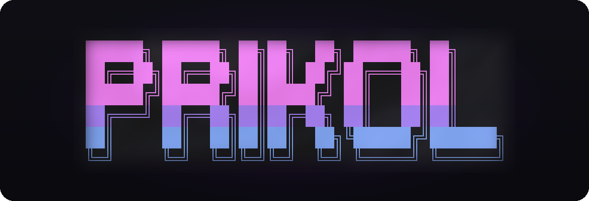
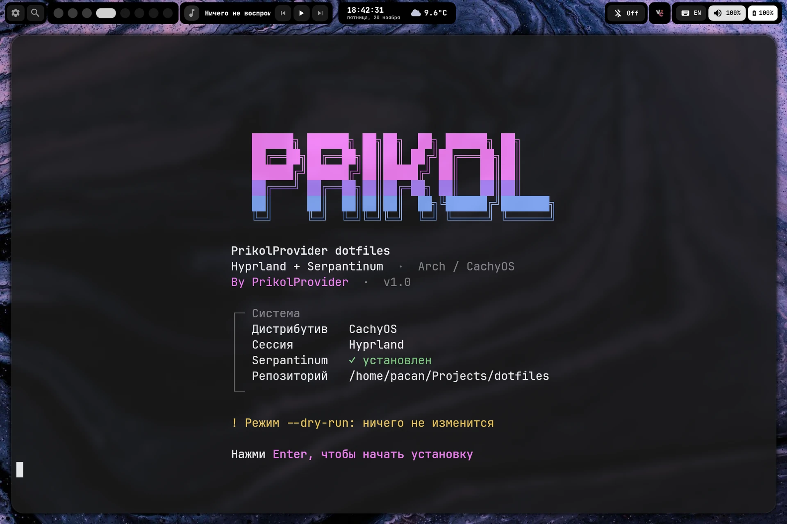
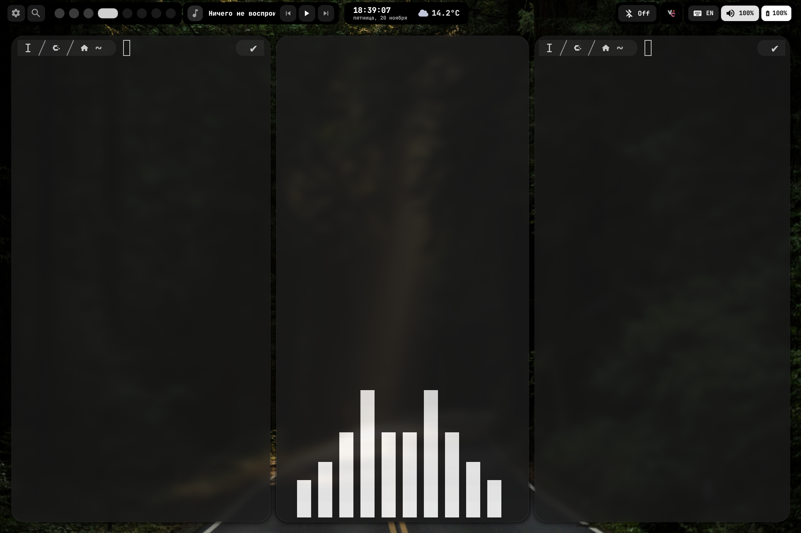
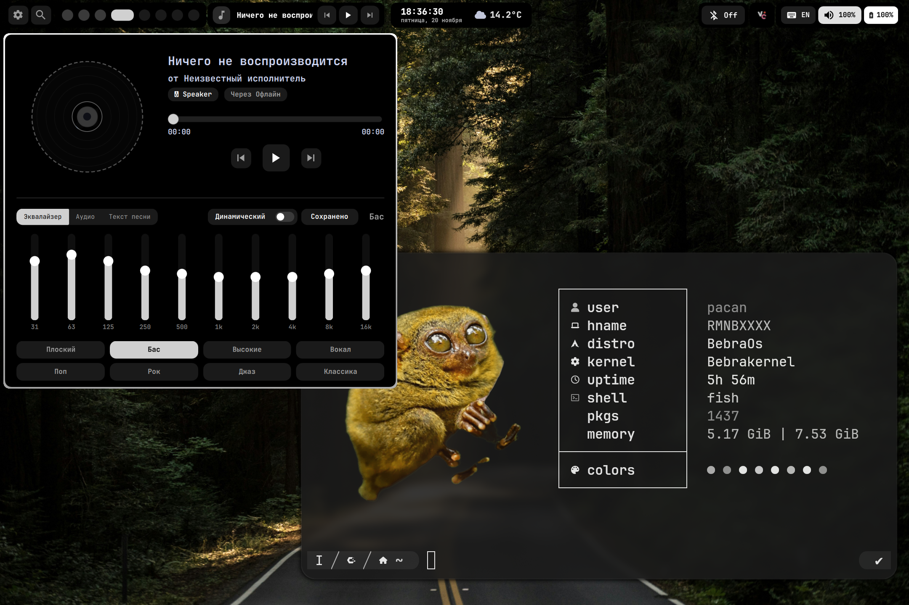

<div align="center">
  
</div>

<h1 align="center">dotfiles</h1>

<p align="center">
  Мои конфиги для Hyprland. Собраны под себя, без претензии на универсальность.
</p>

<p align="center">
  
  
  
  
  
  
</p>

<p align="center">
  <a href="#-установка">Установка</a> ·
  <a href="#-скриншоты">Скриншоты</a> ·
  <a href="#-клавиши">Клавиши</a> ·
  <a href="#-структура">Структура</a> ·
  <a href="#-пакеты">Пакеты</a> ·
  <a href="#-faq">FAQ</a> ·
  <a href="#-спасибо">Спасибо</a>
</p>

---

Это мой рабочий стол. Я не делал из него дистрибутив: часть вещей завязана на железо, часть — на привычки, которые мне лень менять. Но если тебе зайдёт — забирай, мне не жалко.

**Hyprland** у меня на Lua (`hyprland.lua`). Да, я попробовал и оставил. Бар и панели — [Serpantinum](https://github.com/ilyamiro/serpantinum), терминал — kitty, шелл — fish со starship, файлы — ski.

<a href="assets/screenshots/1.png"></a>

<sub>Главный рабочий стол: три окна, cava по центру, Serpantinum бар сверху. Обои тоже лежат в репозитории.</sub>

---

## 🎯 Что внутри

| Компонент | Что использую |
|:---|:---|
| **Оконный менеджер** | Hyprland, конфиг на Lua (`hyprland.lua`) |
| **Бар и панели** | Serpantinum (топ-бар, панель уведомлений, OSD) |
| **Терминал** | kitty + тема Serpantinum |
| **Шелл** | fish + starship prompt |
| **Файловый менеджер** | ski (TUI) + yazi |
| **Лаунчер** | hyprlauncher (SUPER+R) |
| **Запуск приложений** | fuzzel (rofi-подобный) |
| **Тема** | Serpantinum: GTK 3/4, Qt5/6 (Kvantum), kitty, cava, fuzzel |
| **Шрифты** | JetBrainsMono Nerd Font, FiraCode Nerd Font |
| **Обои** | 221 штука в `wallpapers/` (папки `current/` и `hyprconf/`) |
| **Скрипты** | мелочи для себя в `bin/` |
| **Системный мониторинг** | btop, cava, fastfetch |
| **Уведомления** | satty (аннотации скриншотов) + Serpantinum |

Пакеты, из которых это собрано, лежат в `packages/`: **236** из pacman, **16** из AUR, **7** flatpak.

---

# 🚀 Установка

Полный пошаговый туториал — от чистой системы до работающего рабочего стола.

### 📋 Что нужно перед стартом

- **Arch Linux** или производная (у меня **CachyOS** — рекомендую, уже настроен под производительность)
- `git` и `rsync` (нужны для установщика)
- ~**500 МБ** свободного места (конфиги + обои + кэш)
- Запускать **не от root** — `sudo` установщик попросит сам, где нужно

```bash
sudo pacman -S --needed git rsync
```

> ⚠️ **Важно**: Если ставишь на чистый Arch (не CachyOS) — некоторые пакеты в `packages/pacman.txt` специфичны для CachyOS (`cachyos-*`, `linux-cachyos`, `cachyos-hello`, и т.д.). Лучше сначала глянуть список и убрать лишнее, или ставить через `--packages` выборочно.

---

### 1️⃣ Клонируем репозиторий

```bash
git clone https://github.com/PrikolProvider/dotfiles.git ~/dotfiles
cd ~/dotfiles
```

---

### 2️⃣ Смотрим, что будет (dry-run)

Перед установкой **всегда** запускай dry-run — он покажет полный план действий, не трогая файлы:

```bash
./install.sh --dry-run
```

Откроется полноэкранное интро (очищает терминал, центрирует баннер, печатает ASCII-лого посимвольно):

<a href="assets/screenshots/installer.webp"></a>

Жмёшь **Enter** — установщик покажет план:

```
┌─ Система
│  Дистрибутив   CachyOS
│  Сессия        Hyprland
│  Serpantinum   ✓ установлен
│  Репозиторий   ~/dotfiles
└─

▸ [1/6] Конфиги → ~/.config
  ✓ 39 конфигов
▸ [2/6] Дотфайлы → ~/
  ✓ 12 файлов
▸ [3/6] Скрипты → ~/.local/bin
  ✓ 4 скрипта
▸ [4/6] Обои → ~/Pictures/Wallpapers
  ✓ 221 обоев (со спиннером)
▸ [5/6] GTK/Qt темы → применены
▸ [6/6] Шрифты → обновлён кэш
```

Никакого мусора в консоли. Видно только шаги и галочки. Если команда упадёт — покажет именно её и её вывод.

---

### 3️⃣ Запускаем установку

```bash
./install.sh
```

Снова интро, снова **Enter**. Дальше он молча раскладывает файлы:

- `config/` → `~/.config` (39 конфигов: hypr, serpantinum, fish, kitty, gtk, qt, kitty, cava, fastfetch, btop, yazi, satty, fuzzel, zed и др.)
- `home/` → `~/` (`.bashrc`, `.bash_profile`, `.zshrc`, `.gtkrc-2.0`, `.gitconfig` — последний **не трогается**, если уже есть)
- `bin/` → `~/.local/bin` (скрипты: `pacman-root`, `ffcard`, `chromium`, `photocraft-host`)
- `wallpapers/` → `~/Pictures/Wallpapers` (221 обоев, копируются со спиннером)

**Всё, что уже было на этих местах, переезжает в бэкап:**
```
~/.local/state/dotfiles-backup/YYYYMMDD-HHMMSS/
├── config/
├── home/
└── bin/
```
Ничего не удаляется никогда.

---

### 4️⃣ Пакеты, Serpantinum и fish (по желанию, но рекомендую)

Установщик **не ставит пакеты автоматически** — это осознанный выбор. Ты решаешь, что нужно.

```bash
# 1. Базовые пакеты из pacman (236 штук)
./install.sh --packages

# 2. AUR-пакеты (16 штук, нужен yay или paru)
./install.sh --aur

# 3. Flatpak-приложения (7 штук)
./install.sh --flatpak

# 4. Serpantinum (бар и панели) — официальный скрипт с install.serpantinum.dev
./install.sh --serpantinum

# 5. Сделать fish шеллом по умолчанию (chsh -s fish)
./install.sh --shell
```

**Можно всё сразу (рекомендую для чистой системы):**

```bash
./install.sh --packages --aur --flatpak --serpantinum --shell
```

> ⚠️ **Предупреждения, честно:**
> - Список пакетов собран на **CachyOS**. Часть `cachyos-*` и `linux-cachyos` есть не в каждом репозитории — на чистом Arch лучше глянуть `packages/pacman.txt` и почистить.
> - `--serpantinum` запускает установщик с `install.serpantinum.dev`. Это сторонний проект, я его не вендорю и не контролирую.
> - `--shell` делает `chsh -s $(command -v fish)`, спросит пароль.
> - **Без Serpantinum** конфиг Hyprland запустится, но **бара и панелей не будет**.

---

### 5️⃣ Перезаходим в сессию

Выйди из Hyprland (SUPER+M → Log out) и зайди снова — Hyprland подхватит конфиг.

Если бар не появился:

```bash
serpantinumd start
```

---

### 📋 Все флаги установщика

| Флаг | Что делает |
|:---|:---|
| `--dry-run` | Показать план, ничего не менять |
| `--packages` | Поставить пакеты из `packages/pacman.txt` |
| `--aur` | Поставить AUR-пакеты из `packages/aur.txt` (нужен yay/paru) |
| `--flatpak` | Поставить flatpak из `packages/flatpak.txt` |
| `--serpantinum` | Поставить Serpantinum официальным скриптом |
| `--shell` | Сменить шелл на fish (`chsh`) |
| `--no-intro` | Без анимации интро |
| `--no-color` | Без цветов в выводе |
| `--verbose` | Показывать выполняемые команды |
| `-y`, `--yes` | Не ждать Enter (для CI/скриптов) |
| `-h`, `--help` | Справка |

---

### 🔧 Если что-то пошло не так

**Бэкапы лежат здесь:**

```bash
ls ~/.local/state/dotfiles-backup/
```

**Вернуть, например, конфиг Hyprland:**

```bash
rm -rf ~/.config/hypr
cp -a ~/.local/state/dotfiles-backup/<дата>/config/hypr ~/.config/hypr
```

**Если сломался вход в Hyprland:**
1. `Ctrl+Alt+F2` — вход в TTY
2. Логинишься
3. Возвращаешь конфиг (команда выше)
4. Набираешь `Hyprland` и заходишь заново

---

### 🐛 Частые мелочи и решения

| Проблема | Решение |
|:---|:---|
| **Нет иконок или курсор** | Поставь `kora` и `bibata-cursor-theme` из AUR: `./install.sh --aur` |
| **Квадраты вместо иконок в терминале** | Нет Nerd Font: `sudo pacman -S ttf-jetbrains-mono-nerd ttf-firacode-nerd` |
| **`serpantinumd: command not found`** | `./install.sh --serpantinum` |
| **Нет обоев** | Установщик кладёт их в `~/Pictures/Wallpapers` (или в `$XDG_PICTURES_DIR`) |
| **GTK/Qt приложения выглядят криво** | `./install.sh --packages` тянет `gtk3`, `gtk4`, `qt5ct`, `qt6ct`, `kvantum` — темы применяются автоматически |
| **Звук не регулируется** | Проверь `wpctl` / `pamixer` — в конфиге бинды на мультимедийные клавиши стандартные |

---

### 🔄 Как обновлять

```bash
cd ~/dotfiles
git pull
./install.sh
```

Текущие конфиги снова уедут в бэкап — так что откатиться можно в любой момент.

---

# 📸 Скриншоты

| Рабочий стол | Редактор + терминал |
|:---:|:---:|
| <a href="assets/screenshots/1.png"></a> | <a href="assets/screenshots/2.png"></a> |
| <sub>Главный взгляд: Hyprland + Serpantinum бар + cava + обои из репы</sub> | <sub>Код в Zed/Neovim, справа — kitty с fish + starship</sub> |

| Fastfetch + плеер | Установщик (интро) |
|:---:|:---:|
| <a href="assets/screenshots/3.png"></a> | <a href="assets/screenshots/4.png"></a> |
| <sub>Fastfetch, плеер, эквалайзер. Кот на обоях тоже из репы.</sub> | <sub>Полноэкранное интро с typewriter-эффектом ASCII-лога</sub> |

| Дополнительно: редактор | Дополнительно: инфо |
|:---:|:---:|
| <a href="assets/screenshots/editor.webp"></a> | <a href="assets/screenshots/info.webp"></a> |
| <sub>Справа `hyprland.lua`, слева — терминал</sub> | <sub>Fastfetch, плеер, эквалайзер</sub> |

---

# ⌨️ Клавиши

`SUPER` = Win (мод-клавиша). Основное:

| Клавиши | Действие |
|:---|:---|
| `SUPER + Enter` | Открыть kitty |
| `SUPER + E` | Открыть ski (файловый менеджер) |
| `SUPER + R` | hyprlauncher (запуск приложений) |
| `SUPER + Q` | Закрыть окно |
| `SUPER + F` | Фуллскрин |
| `SUPER + C` | Сделать окно плавающим |
| `SUPER + J` | Переключить split (horizontal/vertical) |
| `SUPER + 1…0` | Переключить рабочий стол |
| `SUPER + SHIFT + 1…0` | Перенести окно на рабочий стол |
| `SUPER + S` | Special workspace `magic` (скрытый слой) |
| `SUPER + ЛКМ` | Таскать окно |
| `SUPER + ПКМ` | Ресайз окна |
| `SUPER + M` | Меню выхода / выключения |
| `Print` | Скриншот области (satty) |
| `SHIFT + Print` | Скриншот всего экрана |
| `SUPER + Ctrl + A` | Скриншот через Serpantinum |

**Звук и яркость** — на мультимедийных клавишах (F1-F12 / спец. клавиши), там всё стандартно через `wpctl` / `brightnessctl`.

Полный список — в `config/hypr/hyprland.lua` (секция `binds`).

---

# 📁 Структура репозитория

```text
.
├── assets/                    Картинки для README
│   ├── banner.png             Баннер репозитория
│   └── screenshots/           Скриншоты (PNG + WebP)
│       ├── 1.png              Главный рабочий стол
│       ├── 2.png              Редактор + терминал
│       ├── 3.png              Fastfetch + плеер
│       ├── 4.png              Интро установщика
│       ├── desktop.webp       (старые вебп-версии)
│       ├── editor.webp
│       ├── info.webp
│       └── installer.webp
├── bin/                       → ~/.local/bin
│   ├── pacman-root            Запуск pacman с sudo (удобный wrapper)
│   ├── ffcard                 Генератор карточек fastfetch
│   ├── chromium               Запуск Chromium с флагами
│   └── photocraft-host        Хостинг для фото (мой скрипт)
├── config/                    → ~/.config
│   ├── hypr/                  Hyprland конфиг (Lua!)
│   │   ├── hyprland.lua       Главный конфиг
│   │   ├── hyprpaper.conf     Обои
│   │   ├── pypr/              Pypr конфиги
│   │   └── blur/              Blur-эффекты
│   ├── serpantinum/           Настройки бара и панелей
│   ├── fish/                  config.fish, функции, темы starship
│   ├── kitty/                 kitty.conf + тема Serpantinum
│   ├── gtk-3.0/               GTK3 тема (Serpantinum)
│   ├── gtk-4.0/               GTK4 тема (Serpantinum)
│   ├── qt5ct/                 Qt5 (Kvantum)
│   ├── qt6ct/                 Qt6 (Kvantum)
│   ├── Kvantum/               Kvantum тема
│   ├── cava/                  Эквалайзер (визуализатор)
│   ├── fastfetch/             Конфиг + ASCII лого
│   ├── btop/                  Топ
│   ├── yazi/                  TUI файловый менеджер
│   ├── satty/                 Аннотации скриншотов
│   ├── fuzzel/                Лаунчер (rofi-like)
│   ├── zed/                   Редактор Zed
│   └── ...                    htop, starship, и остальное
├── home/                      → ~/
│   ├── .bashrc
│   ├── .bash_profile
│   ├── .zshrc
│   ├── .gtkrc-2.0
│   └── .gitconfig             (не перезаписывается, если существует)
├── packages/                  Списки пакетов
│   ├── pacman.txt             236 пакетов (pacman)
│   ├── aur.txt                16 пакетов (AUR)
│   └── flatpak.txt            7 пакетов (flatpak)
├── wallpapers/                221 обоев
│   ├── current/               Текущие любимые
│   └── hyprconf/              Из hyprconf коллекции
├── install.sh                 Установщик (bash, ~2000 строк)
└── README.md                  Этот файл
```

---

# 📦 Пакеты (кратко)

<details>
<summary><b>pacman.txt (236 пакетов) — нажми, чтобы развернуть</b></summary>

```text
# Базовая система
base-devel linux-cachyos linux-cachyos-headers cachyos-kernel-manager
cachyos-settings cachyos-hello cachyos-alacritty-config cachyos-btrfs-support
cachyos-fish-config cachyos-gnome-defaults cachyos-kde-defaults
cachyos-mako-config cachyos-nvidia-support cachyos-pacman-hooks
cachyos-rate-mirrors cachyos-reflector-simple cachyos-timeshift-config
cachyos-vfio-config cachyos-zoomer-config

# Hyprland экосистема
hyprland hyprpaper hyprlock hypridle hyprpolkitagent hyprcursor
hyprland-qtutils hyprland-qt-support xdg-desktop-portal-hyprland
qt5-wayland qt6-wayland

# Serpantinum (бар/панели) — ставится отдельно через --serpantinum
# Но нужны зависимости:
gtk3 gtk4 libadwaita qt5ct qt6ct kvantum kvantum-qt5

# Терминал и шелл
kitty fish starship ttf-jetbrains-mono-nerd ttf-firacode-nerd
noto-fonts noto-fonts-emoji noto-fonts-cjk

# Файловые менеджеры
yazi ski eza bat fd ripgrep fzf zoxide

# Мониторинг и инфо
btop cava fastfetch htop

# Лаунчеры и меню
fuzzel wofi rofi-wayland

# Уведомления и скриншоты
mako satty grim slurp swappy

# Мультимедиа
pipewire wireplumber pavucontrol pamixer playerctl mpv

# Браузеры
firefox chromium

# Разработка
git github-cli neovim zed code rustup cargo nodejs npm pnpm bun
docker docker-compose podman buildah

# Архивы и утилиты
unzip unrar p7zip tar rsync reflector pacman-contrib
paru yay  # AUR helpers

# Остальное (темы, курсоры, иконки)
kora-icon-theme bibata-cursor-theme papirus-icon-theme
adw-gtk-theme materia-gtk-theme
```
</details>

<details>
<summary><b>aur.txt (16 пакетов)</b></summary>

```text
hyprlauncher-git          # Лаунчер (SUPER+R)
serpantinum-git           # Бар и панели (официальный — через --serpantinum)
pypr-git                  # Python плагины для Hyprland
hyprland-protocols-git    # Протоколы
grimblast-git             # Скриншоты (альтернатива grim)
swww-git                  # Обои (альтернатива hyprpaper)
waybar-module-pacman-updates-git
ttf-maple-mono-nf         # Красивый моноширинный шрифт
nerd-fonts-jetbrains-mono # Nerd fonts
visual-studio-code-bin    # VS Code
google-chrome             # Chrome
discord                   # Discord
spotify                   # Spotify
obsidian                  # Obsidian
localsend                 # Передача файлов
ventoy-bin                # Загрузочные флешки
```
</details>

<details>
<summary><b>flatpak.txt (7 пакетов)</b></summary>

```text
com.bitwarden.desktop           # Bitwarden
com.discordapp.Discord          # Discord (flatpak версия)
com.obsproject.Studio           # OBS Studio
com.spotify.Client              # Spotify
md.obsidian.Obsidian            # Obsidian
org.localsend.localsend_app     # LocalSend
org.telegram.desktop            # Telegram
```
</details>

---

# ❓ FAQ

<details>
<summary><b>Почему Hyprland на Lua?</b></summary>
Потому что конфиг на чистом `hyprland.conf` превращается в спагетти через месяц. Lua даёт переменные, функции, циклы, импорты — конфиг становится читаемым и поддерживаемым. `hyprland.lua` компилируется в обычный конфиг при запуске через `hyprland --config ~/.config/hypr/hyprland.lua`.
</details>

<details>
<summary><b>Что такое Serpantinum и почему не waybar?</b></summary>
[Serpantinum](https://github.com/ilyamiro/serpantinum) — это не просто бар, а целая оболочка для Hyprland: топ-бар, панель уведомлений, OSD (яркость/звук), локскрин, меню выхода, скриншоты — всё в едином стиле, на GTK4/Lua, очень быстрый и красивый "из коробки". Waybar требует кучу конфигов для похожего результата.
</details>

<details>
<summary><b>Можно ли использовать на другом дистрибутиве (не Arch/CachyOS)?</b></summary>
Конфиги — да, они просто файлы в `~/.config`. Установщик с флагами `--packages/--aur/--flatpak` — нет, они заточены под pacman/AUR/flatpak. На Fedora/NixOS/Ubuntu придётся ставить пакеты вручную через свой менеджер, а потом запускать `./install.sh` без флагов пакетов.
</details>

<details>
<summary><b>Как добавить свои обои?</b></summary>
Клади в `wallpapers/current/` или `wallpapers/hyprconf/`, потом `./install.sh` скопирует их в `~/Pictures/Wallpapers`. В `hyprpaper.conf` уже стоит `wallpaper = ~/Pictures/Wallpapers` — hyprpaper сам выберет случайные или по порядку.
</details>

<details>
<summary><b>Как поменять тему/цвета?</b></summary>
Всё лежит в `config/serpantinum/` (тема бара), `config/gtk-3.0/`, `config/gtk-4.0/`, `config/Kvantum/`, `config/kitty/`. Serpantinum тема — единственный источник правды для цветов, GTK/Qt/Kitty подтягивают оттуда.
</details>

<details>
<summary><b>Почему fish, а не zsh/bash?</b></summary>
Автодополнения "из коробки", синтаксис понятнее, starship prompt летает, конфиг в `~/.config/fish/config.fish` — один файл, никаких `.zshrc` на 500 строк. `./install.sh --shell` переключит дефолтный шелл.
</details>

---

# 🙏 Спасибо

- **[Serpantinum](https://github.com/ilyamiro/serpantinum)** — сам шелл/бар/панели. В репозитории только мои настройки, исходники не вендорю. AGPL-3.0.
- **[hyprconf](https://github.com/shell-ninja/hyprconf)** — отсюда выросли fish, kitty и часть GTK/Qt-конфигов. MIT.
- **[Hyprland](https://hypr.land)** — лучший WM, который я пробовал.
- **[CachyOS](https://cachyos.org)** — Arch, но быстрее и удобнее.
- Всем, чьи конфиги я когда-то читал на GitHub / Dotfiles / Reddit — вы знаете, кто вы.

---

<div align="center">
  <sub>Собрано на CachyOS. Если что-то не завелось — открывай issue, но сначала глянь бэкапы (`~/.local/state/dotfiles-backup/`) и вывод терминала.</sub>
</div>

<div align="center">
  <br>
  <b>By PrikolProvider</b>
</div>

<div align="center">
  <a href="#top"></a>
</div>